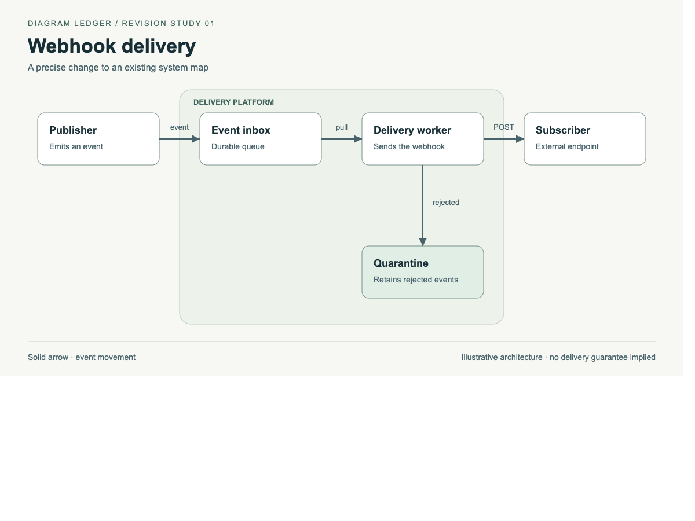

# Diagram Ledger

**Draw clearly. Revise deliberately. Leave a record.**

**Version 3.2.2:** brainstorm through conversation, keep diagrams and notes together, and generate all-format bundles. Lucidchart and SmartDraw import options remain **beta**, with destination-app testing pending. See the [import test guide](docs/IMPORT-TESTING.md).

A portable diagram skill for **Claude Code and Cursor**. Create editable draw.io, Excalidraw, Mermaid or SVG diagrams, then revise them without silently rearranging the owner's work. No marketplace setup or MCP server is required.

Version 3 adds **revision contracts**: capture the original, allow only the requested changes, verify the required result, and deliver a readable receipt with exact before/after sources and fingerprints. A changed label should not quietly become a changed connection, moved boundary or redesigned page.

[Browse the examples](examples/README.md) · [Explore the revision study](skills/diagram-ledger/assets/revision/README.md) · [Read the skill](skills/diagram-ledger/SKILL.md) · [Validation summary](docs/EVALUATION.md)



## Quick install

These steps are for **Claude Code** and **Cursor Agent** on your computer. Have either application installed, plus Python 3.9 or newer. Claude chat/Cowork uploads use a different installation route.

### 1. Download and open the package

Download the [portable ZIP](https://github.com/mattkijewski/diagram-ledger/releases/latest/download/diagram-ledger-portable.zip), extract it, and open a terminal in the extracted `diagram-ledger-package` folder—the folder containing `install.py`.

Or, if you use Git:

```sh
git clone https://github.com/mattkijewski/diagram-ledger.git
cd diagram-ledger
```

### 2. Run the command for your application

Run **one** of these commands from that folder. This installs the skill for your user account so you can use it across projects.

**Claude Code:**

```sh
python3 install.py --target claude --scope user
```

**Cursor:**

```sh
python3 install.py --target cursor --scope user
```

**Both applications:**

```sh
python3 install.py --target both --scope user
```

On **Windows**, replace `python3` with `py -3`, for example:

```powershell
py -3 install.py --target both --scope user
```

### 3. Make your first diagram

Open the project you want to diagram. Start a new Claude Code session or a new **Agent** chat in Cursor, then send:

```text
/diagram-ledger Draw an editable architecture diagram of this project.
Inspect the code first and save the result as diagrams/project-architecture/project-architecture.drawio.
```

You can also ask naturally: “Use Diagram Ledger to draw a flowchart of our sign-up process.”

If the skill does not appear, restart the application and check that `SKILL.md` is directly inside the installed `diagram-ledger` folder listed below. If the installer reports “Already exists,” use the [update command](#updating-or-migrating-from-diagram-craft).

### Other installation options

**Only one project:** replace `/path/to/project` with your project's folder. Use `--target claude` or `--target cursor` to install for just one application.

```sh
python3 install.py --target both --scope project --project "/path/to/project"
```

**Manual copy:** download and extract the [skill ZIP](https://github.com/mattkijewski/diagram-ledger/releases/latest/download/diagram-ledger-skill.zip), then copy the entire `diagram-ledger` folder to one of these locations. Create the `skills` folder if it does not exist. Keep the included `scripts`, `references`, `assets` and `LICENSE` together with `SKILL.md`; copying just `SKILL.md` is not enough. Python 3.9+ is still needed for the bundled checks.

| Application | All your projects | One project (inside its root folder) |
| --- | --- | --- |
| Claude Code | `~/.claude/skills/diagram-ledger/` | `.claude/skills/diagram-ledger/` |
| Cursor | `~/.cursor/skills/diagram-ledger/` | `.cursor/skills/diagram-ledger/` |

`~` means your home folder. On Windows, the personal locations are `%USERPROFILE%\.claude\skills\diagram-ledger\` and `%USERPROFILE%\.cursor\skills\diagram-ledger\`.

Add `--dry-run` to an installer command to preview its destinations without copying files. Skill discovery follows the application's version and settings.

### Updating or migrating from Diagram Craft

```sh
python3 install.py --target both --scope user --update
```

Updates retain the previous installation in the application's `skill-backups` directory. If the old `diagram-craft` installation exists, `--update` also moves it to that backup directory so only the new skill is discovered. Customizations are preserved in the backup, not silently merged. Dry-run shows both actions. Existing symlinks and unrecognized folders are refused. To uninstall, remove only the installed `diagram-ledger` directory.

Copies do not auto-update. Keep the canonical files under `skills/diagram-ledger`, then rerun the installer after updating them. Project style lives in `diagram-ledger.style.md`; the previous `diagram-craft.style.md` is accepted if no new-name file exists.

### Use it from any repository

Install once for your user account, from the downloaded package or this repository:

```sh
python3 install.py --target claude --scope user --update
```

Then start Claude in whichever repository you want to diagram:

```sh
cd /path/to/another-repo
claude
```

```text
/diagram-ledger Draw this project's architecture in all formats.
```

The skill creates `diagrams/<subject-and-view>/` **inside that repository**. It does not save outputs in the skill's installation or this package. There is no need to copy the skill into each repo. Personal skills live at `~/.claude/skills/diagram-ledger/` and are available across projects.

For Cursor, install with `--target cursor --scope user --update` and open the target repository in a new Agent chat. If a repository has an older project-specific copy, update that copy too so it does not conflict with the personal installation. On another machine, install the same package there once.

## Use it

### Where files are saved

Generated files go in **`diagrams/<subject-and-view>/` inside your active project**, with one folder per diagram and descriptive lowercase kebab-case names:

```text
diagrams/
  payment-service-architecture/
    payment-service-architecture.drawio
    exports/drawio/payment-service-architecture.png
  content-review-flow/
    content-review-flow.drawio
    content-review-flow.excalidraw
    content-review-flow.mmd
    content-review-flow.svg
    content-review-flow-lucidchart.drawio
    content-review-flow-smartdraw.vson
    model.json
    README.md
```

The first example is a single-format diagram with an optional preview; the second is an all-format bundle. Exports use `exports/<format>/` within the diagram folder. Revision baselines, contracts and receipts use `revisions/<revision>/`; originals are preserved. Existing diagrams are not moved automatically. Only an explicit request for a different location overrides this convention.

### Pick your output format

Ask “Draw a diagram of this project” and the skill will ask which format you want before drawing:

| Choice | Best for | Editable file |
| --- | --- | --- |
| 1. draw.io | Structured architecture and flowcharts | `.drawio` |
| 2. Excalidraw | Sketch-style whiteboards and idea mapping | `.excalidraw` |
| 3. Mermaid | Technical diagrams maintained alongside code | `.mmd` |
| 4. SVG | Slides and publication graphics | `.svg` |
| 5. Lucidchart (beta) | Import into an existing Lucidchart workflow | `.drawio`, saved/exported through draw.io before import |
| 6. SmartDraw (beta) | Generate a basic flowchart using SmartDraw's layout engine | `.vson` VisualScript import |
| 7. All formats | One bundle for all six destinations, including beta imports | All six source files, a shared inventory and an index |

Reply with the name or number, or say “choose for me.” This is a question in your Claude Code or Cursor conversation, not a separate app or installer menu. One installation includes the four stable formats and two beta import destinations. “Choose for me” uses a stable format unless you explicitly request or configure a beta destination.

The skill shows all seven choices together as a numbered list in the chat. Reply `5` for Lucidchart, `6` for SmartDraw, `7` or `all` for the bundle, or type the name. This avoids constrained question menus and requires only one choice. Name the destination in your original prompt to skip the list entirely.

“All formats” uses one shared diagram model and checks each representation against it. SmartDraw currently supports basic flowcharts only: if it cannot faithfully represent the requested diagram, the skill completes the other sources and explains that limitation in the bundle index. It does not label a partial bundle complete. See the [all-format workflow](skills/diagram-ledger/references/all-formats.md).

```text
/diagram-ledger Draw our content review flow in all formats:
Draft goes to Review; approval leads to Published;
requested edits lead to Revise, which returns to Draft.
```

Lucidchart and SmartDraw are **import workflows**, not native `.lucid`/`.sdr` file writers. Import fidelity and editing still need testing in the destination apps. Lucidchart requires a paid plan to edit imported documents. See the [beta test guide](docs/IMPORT-TESTING.md) for both apps.

Already know what you want? Name the format or filename in your prompt to skip the question. Edits keep the existing format, and a preferred format in `diagram-ledger.style.md` also skips the question.

```text
/diagram-ledger Create an Excalidraw diagram of our review process.
Use native editable shapes, labels and bound arrows.
Save diagrams/content-review-flow/content-review-flow.excalidraw.
```

Open the resulting `.excalidraw` file in Excalidraw using **Open** or drag it onto the canvas. The source remains editable; PNG/SVG exports are optional. Try the included [Excalidraw example](skills/diagram-ledger/assets/review-flow.excalidraw) or read the [format guide](skills/diagram-ledger/references/excalidraw.md).

### Brainstorm a new project

Start with an idea, even in an empty project folder:

```text
/diagram-ledger Help me brainstorm the architecture for a new game.
Ask me one focused question at a time, discuss the tradeoffs,
and build the diagram with me as we make decisions.
```

Diagram Ledger explores the idea before asking for an output format. Once there is enough context to sketch, choose a format or All formats. Keep chatting naturally:

- “What would change if we added co-op?”
- “Keep it single-player for now.”
- “Add local saves and show what depends on them.”
- “Compare those two options without replacing the current design.”
- “Use the second option and update the diagram.”

“What if” explores a proposal; accepting the proposal changes the working design. Meaningful diagram changes preserve earlier sources and use the revision workflow. The chosen output format stays in effect.

The diagram and concise notes live together, for example:

```text
diagrams/farming-game-architecture/
  farming-game-architecture.excalidraw
  brainstorm.md
  revisions/
```

The notes track decisions, assumptions, open questions and the current diagram. In a later session, ask:

```text
/diagram-ledger Continue the brainstorm in diagrams/farming-game-architecture/.
Read the notes and current diagram first.
```

Keep that folder with the project to resume on another machine. The same workflow supports other projects and processes; it is not limited to games. See the [brainstorming guide](skills/diagram-ledger/references/brainstorm.md).

### More prompts

```text
/diagram-ledger Draw an editable architecture diagram of this project.
Inspect the relevant code first. Label uncertain relationships as assumptions.
Save diagrams/project-architecture/project-architecture.drawio.
```

```text
/diagram-ledger Revise this diagram to add a rights check between review
and publication. Preserve the existing IDs, layout, styling and other edges.
Capture the original first and give me the revised source plus a revision receipt.
```

```text
/diagram-ledger Create a Mermaid sequence diagram for our publish flow.
Show duplicate requests and notification failures; use only behavior in the code.
```

```text
/diagram-ledger Make an SVG explaining this process for a slide.
Use a light background and keep labels readable at 1000 px display width.
```

Copy [style.example.md](skills/diagram-ledger/assets/style.example.md) to `diagram-ledger.style.md` in the project root for reusable visual preferences and a default format.

### Use diagrams in Confluence

**draw.io and Lucidchart are enough for the supported workflows.** Confluence is a publishing destination, so it does not add another format to the menu.

| Your setup | Recommended route |
| --- | --- |
| draw.io app installed in Confluence | Create `.drawio`, import it through the app's editor and embed the diagram. |
| Team already uses Lucidchart | Import the prepared source into Lucidchart, verify it, then embed that document with the Lucid integration. Confluence Cloud integration requires Team or Enterprise and admin configuration. |
| No diagram integration installed | Insert a PNG preview and attach the editable source. Replace the PNG when the source changes. |

```text
/diagram-ledger Draw our payment-service architecture in draw.io for Confluence.
Save the editable source and, if a compatible renderer is available, a PNG preview.
Give me a caption and instructions for adding them to the page.
```

See the [Confluence guide](skills/diagram-ledger/references/confluence.md) for the handoff workflow. Local source validation does not verify a Confluence embed; Lucidchart import remains beta.

## What the revision receipt checks

1. Capture the source before editing. The plan stores an exact baseline and inventory.
2. Write a narrow contract from the request: allowed changes plus required outcomes.
3. Edit a separate copy; keep existing identities and unrelated content.
4. Compare the files, render them, and review the receipt alongside the request.

```sh
python3 skills/diagram-ledger/scripts/revision.py plan diagrams/content-review-flow/content-review-flow.drawio --out diagrams/content-review-flow/revisions/01/plan
# Edit diagrams/content-review-flow/revisions/01/plan/contract.json to describe the requested changes, then edit a copy.
python3 skills/diagram-ledger/scripts/revision.py check diagrams/content-review-flow/revisions/01/plan/baseline.drawio diagrams/content-review-flow/content-review-flow-revised.drawio --contract diagrams/content-review-flow/revisions/01/plan/contract.json --out diagrams/content-review-flow/revisions/01/review --require-outcomes
```

The check produces `index.html`, `report.json`, the contract and exact before/after sources. Exit status is 0 for a satisfied contract, 1 for unexpected changes, unmet requirements or unused permissions, and 2 for invalid or unsupported input. Output directories are never overwritten.

| Format | Automated revision coverage |
| --- | --- |
| Uncompressed draw.io | All pages/cells, IDs, labels, parent membership, endpoints, geometry/waypoints, styles, stacking order and remaining XML |
| Annotated standalone SVG | Nodes, edges, containers, declared endpoints/membership, source geometry/styles, surviving entity order and remaining XML |
| Excalidraw, Mermaid, HTML, unannotated SVG, compressed/wrapped draw.io | Source diff, explicit inventory and native visual review; no automated field-preservation claim |

Excalidraw has structural checks for basic shapes, text, simple connectors and their bindings. Automated revision receipts do not yet cover Excalidraw; its revisions include a manual change log instead.

A pass proves that this file pair satisfies **this contract**. It does not prove that the contract correctly expresses the user's request, or that source geometry looks right when rendered. Review the contract and final image. See the [revision guide](skills/diagram-ledger/references/revision.md) for the schema and limits.

## Verification

Core checks use only Python's standard library. Optional measured previews use Node.js 18+, Playwright and Chrome/Chromium; no utility downloads dependencies.

The checker also flags likely over-escaped labels, such as visible `&#8212;` instead of an em dash. Use actual Unicode text and let the XML or JSON serializer escape it once. If a diagram intentionally teaches entity codes, review its labels and pass `--allow-literal-entities`; other structural checks still run. The checker reports problems without rewriting the source.

```sh
python3 scripts/run_tests.py
python3 skills/diagram-ledger/scripts/check_diagram.py diagrams/payment-service-architecture/payment-service-architecture.drawio
python3 skills/diagram-ledger/scripts/check_diagram.py diagrams/content-review-flow/content-review-flow.excalidraw
node skills/diagram-ledger/scripts/render.mjs diagrams/content-review-flow/content-review-flow.svg --out diagrams/content-review-flow/exports/svg --browser chrome --strict yes
```

Pass `--modules /path/to/node_modules` if Playwright is outside Node's lookup paths. To install optional tooling in a separate folder yourself:

```sh
npm install --prefix .diagram-ledger-tools playwright@1.62.1
node skills/diagram-ledger/scripts/render.mjs diagrams/content-review-flow/content-review-flow.svg --out diagrams/content-review-flow/exports/svg --browser chrome --modules .diagram-ledger-tools/node_modules
```

The SVG/HTML renderer uses an existing Chrome, blocks HTTP(S), disables page scripts and produces PNG, JSON audit and standalone SVG exports. It measures text bounds, contrast, annotated connections and boundary containment. Native draw.io, Excalidraw and Mermaid previews use their corresponding applications/renderers. Structural checks are not renderers; none of these tools is a security sanitizer.

Set `DIAGRAM_LEDGER_BROWSER_TESTS=1` and optionally `DIAGRAM_LEDGER_NODE_MODULES=/path/to/node_modules` to run the browser regression tests. Otherwise they are explicitly skipped.

## Evidence and scope

The [validation summary](docs/EVALUATION.md) describes the automated checks, exercised workflows and remaining gaps. Teaching examples are included with their sources and receipts so you can inspect the results yourself.

Diagram Ledger focuses on portable diagram creation, conversational brainstorming and reviewable revisions. A passing contract verifies the specified changes for one pair of files; it does not guarantee system correctness or visual quality.

Diagram Ledger is available under the [MIT License](LICENSE). Reuse, modification and commercial use are permitted; retain the copyright and permission notice in copies or substantial portions.

Model quality depends on the task, model and renderer. Workflow trials are limited samples reviewed during development, not an independent reliability study. Native Cursor execution remains untested. GitHub Actions exercises the core utilities, installer tests and archive verification on Linux and Windows; it does not test the desktop applications.

## Package it

```sh
python3 scripts/build_release.py
python3 scripts/verify_release.py
```

- `dist/diagram-ledger-skill.zip`: the installable skill directory.
- `dist/diagram-ledger-portable.zip`: skill, installer, gallery, docs, tests and build tools.
- `dist/manifest.json`: sizes and SHA-256 fingerprints.

Download both ZIPs and their checksums from [GitHub Releases](https://github.com/mattkijewski/diagram-ledger/releases). The portable ZIP includes an interactive HTML gallery; open `examples/index.html` locally after extracting it.
