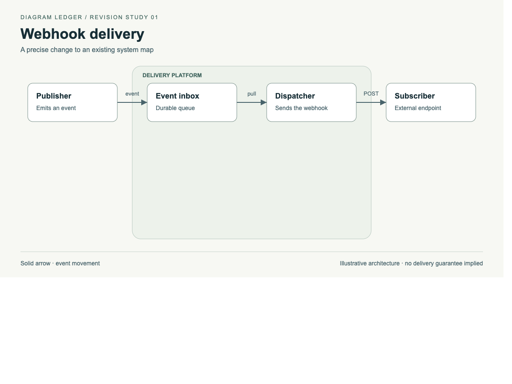
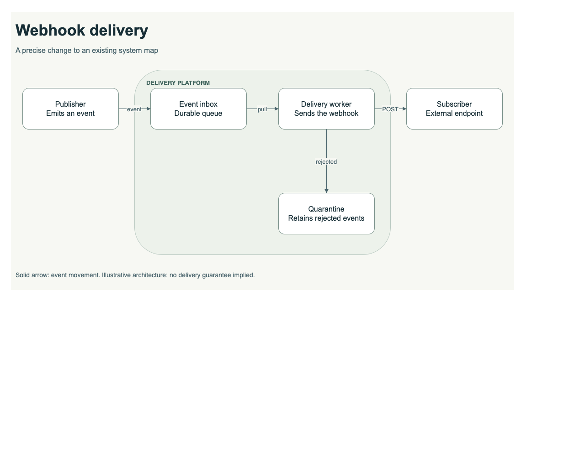
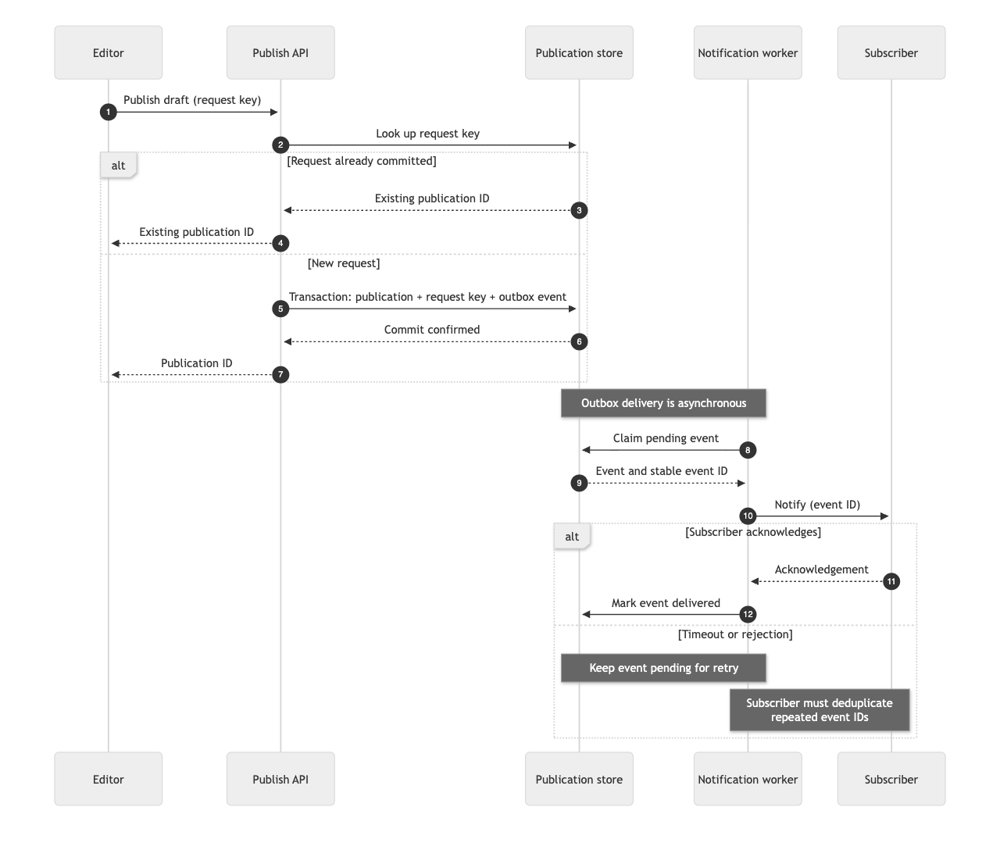
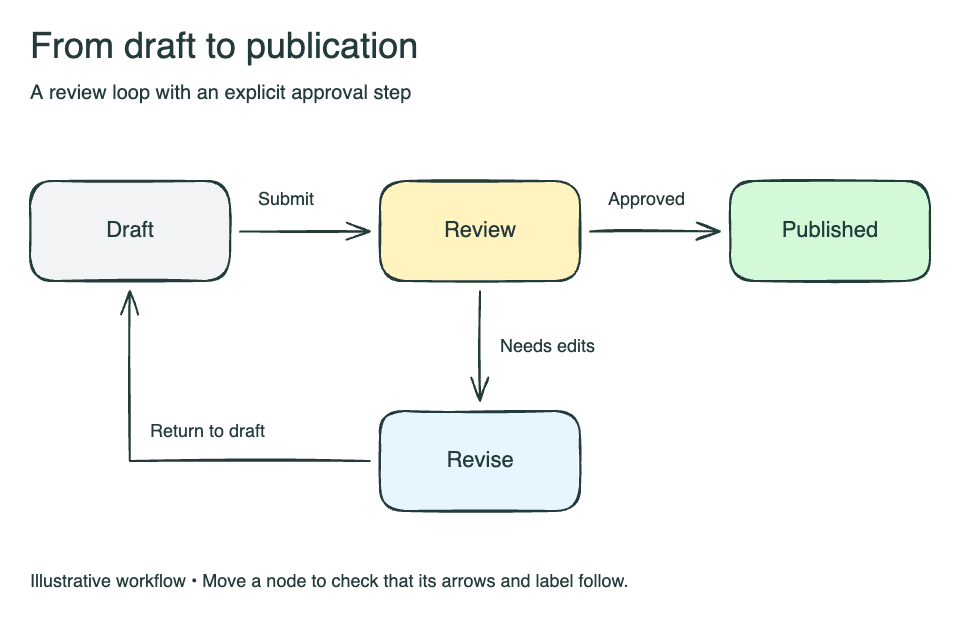

# Examples

These original teaching examples demonstrate the workflow. They include editable sources and verification receipts.

## A controlled revision

Rename Dispatcher to Delivery worker and add a quarantine for rejected events. Preserve every other identity, connection, position and style.

### Before

### After

[Original SVG](../skills/diagram-ledger/assets/revision/svg/before.svg) · [Revised SVG](../skills/diagram-ledger/assets/revision/svg/after.svg) · [Contract](../skills/diagram-ledger/assets/revision/svg/contract.json) · [Machine-readable receipt](../skills/diagram-ledger/assets/revision/svg/receipt/report.json)

The receipt checks three allowed changes and verifies the requested new label, ownership and connection. Rendering and semantic review remain separate checks.

## The same change in native draw.io

[Original draw.io](../skills/diagram-ledger/assets/revision/drawio/before.drawio) · [Revised draw.io](../skills/diagram-ledger/assets/revision/drawio/after.drawio) · [Contract](../skills/diagram-ledger/assets/revision/drawio/contract.json) · [Receipt](../skills/diagram-ledger/assets/revision/drawio/receipt/report.json)

## Make failure behavior visible

[Editable Mermaid source](../skills/diagram-ledger/assets/publish-sequence.mmd)

This is a proposed architecture, not a description of an existing system. Concurrent uniqueness, claim expiration and retry policy need implementation-specific treatment. A timeout does not prove non-delivery.

## Interactive gallery

Download the [portable release](https://github.com/mattkijewski/diagram-ledger/releases/latest/download/diagram-ledger-portable.zip), extract it, and open `examples/index.html` for before/after controls and the HTML receipts. GitHub displays HTML source rather than running it.

[All source examples](../skills/diagram-ledger/assets/README.md) · [Installation](../README.md)

## An editable Excalidraw whiteboard

[Open/download the Excalidraw source](../skills/diagram-ledger/assets/review-flow.excalidraw) and load it using **Open** in Excalidraw. The example shows Draft → Review → Published, with a Needs edits branch returning through Revise to Draft.

The nodes have attached editable labels and bound arrows. Move a node to check the connections, then undo. This format uses structural checks and a manual revision change log, not automated revision receipts. See the [Excalidraw guide](../skills/diagram-ledger/references/excalidraw.md).
